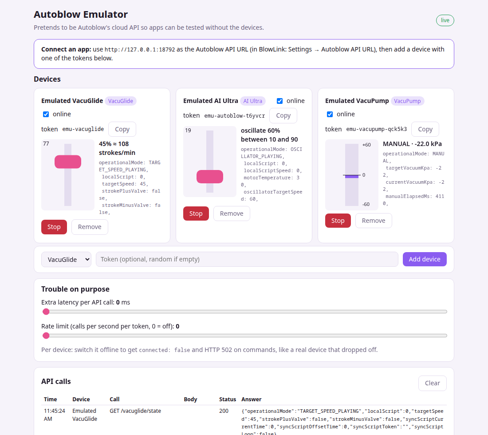

# Autoblow Emulator

A fake of Autoblow's cloud device API (VacuGlide 2, AI Ultra, VacuPump), so you can build and
test apps that control Autoblow devices **without owning the devices**, without a connected
device, and without hitting the real API's rate limits. A web page shows what each emulated
device would be doing, and lets you break things on purpose (device goes offline, slow answers,
rate limiting).



> Unofficial. Not affiliated with Autoblow. It follows [Autoblow's public API docs](https://developers.autoblow.com/)
> and a few measurements on a real VacuGlide 2; where the docs are silent it guesses (see
> [What is and isn't faithful](#what-is-and-isnt-faithful)).

## Run it

You need [Node.js](https://nodejs.org/) 18 or newer. Pick one:

```sh
npx github:driftsyncone/autoblow-emulator          # no install, runs the latest version
```

```sh
# or from a downloaded release (autoblow-emulator-x.y.z.tgz):
npm install -g ./autoblow-emulator-x.y.z.tgz
autoblow-emulator
```

```sh
# or with Docker (listens on 127.0.0.1 only; change the left side of -p to share it):
docker build -t autoblow-emulator .
docker run --rm -p 127.0.0.1:8792:8792 -v autoblow-emulator-data:/data autoblow-emulator
```

Then open **http://127.0.0.1:8792** in a browser. A VacuGlide with the token `emu-vacuglide`
exists from the start; add more devices (any token you like, or a generated one) on the page.

Options: `--port 8792`, `--host 127.0.0.1`, `--data FILE` (where devices are saved).
`--host 0.0.0.0` makes it reachable from other machines on your network; it has no password, so
only do that on a network you trust.

## Point your app at it

Autoblow's apps first ask `https://latency.autoblowapi.com/<device>/connected` which server
their device is on, then talk to that server. Point that first address at the emulator:

| | |
|---|---|
| Base URL | `http://127.0.0.1:8792` instead of `https://latency.autoblowapi.com` |
| Token | `x-device-token: emu-vacuglide` (or any token you added) |
| Paths | the same as the real API: `/vacuglide/...`, `/autoblow/...` (AI Ultra), `/vacupump/...` |

`/<device>/connected` answers with the emulator itself as the `cluster` (a full `http://host:port`
address rather than a cluster name), so clients that follow it keep talking to the emulator. If
your client builds `https://<cluster>` itself, give it the emulator's base URL directly instead.

Works with [BlowLink](https://github.com/driftsyncone/blowlink) (Settings → Advanced → Autoblow
API URL, or `--api-url` on the command line), and with anything else that lets you change the
API address.

## What you get

- **The API:** device state, target speed, valves, local scripts, oscillate and go-to (Ultra), manual /
  pulse / stroke / workout modes (VacuPump), sync scripts (upload funscript or CSV, by file or
  URL, load, start, stop, offset, loop). Requests are validated like the docs say: out-of-range
  values get HTTP 400, a bad token 401, a command to an offline device 502.
- **A live page:** an animated stroker or vacuum gauge per device, its state, and a log of every
  API call and answer as it happens.
- **Fault controls:** take a device offline, add latency to every answer, and set a per-token
  rate limit (answers 429 with Autoblow's message) to see how your app copes.
- **Your devices are remembered** between runs (`~/.config/autoblow-emulator/devices.json`, or
  the platform's equivalent).

## What is and isn't faithful

Paths, request validation, response shapes, state fields and mode names follow Autoblow's
documentation (checked endpoint by endpoint). Where it differs on purpose:

- `/connected` returns the emulator's address **with** `http://` as the `cluster`; the real API
  returns a bare host name (like `eu-central-1.autoblowapi.com`), which would make clients
  switch to https and leave the emulator.
- Script-by-URL uploads accept `http://` so a local file server works (the real API wants https).
- Out-of-range funscript positions are clamped, not rejected (the docs don't say).

Not modelled exactly: motion and timing (strokes use the VacuGlide 2's spec range, Ultra speed is
roughly units per second ÷ 6, pump vacuum changes about 20 kPa per second, a pump REST vents to 0),
anything Autoblow doesn't document (error message text, 401 and 404 bodies, exact rate limits and
what the `x-ratelimit-*` numbers mean, what happens with odd inputs), buttons and firmware. The
source marks these guesses `UNDOCUMENTED`. Treat the emulator as a way to catch your own bugs
early, then check what matters on a real device.

## Controls for breaking things

On the page, per device: **online** switch (offline = `connected: false` and HTTP 502 on
commands), **Stop**, **Remove**. For the whole emulator: extra **latency** on every answer and a
per-token **rate limit** (answers 429 with `retry in 1 seconds`). Programmatic control, for your
own tests, is a small JSON API under `/emu/api/` (the page uses it): `GET snapshot`,
`PUT settings {latencyMs, rateLimitPerSec}`, `POST devices {type, token?, name?}`,
`PATCH devices/<token> {online, name}`, `POST devices/<token>/stop`, `DELETE devices/<token>`,
and `POST devices/<token>/button {type}` to send a button press to anyone on `/events/stream`.
It refuses requests from other websites, so use it from scripts, not from a browser page.

## Development

```sh
node src/server.ts     # runs the TypeScript directly (Node 23.6+, no build)
node scripts/build.mjs # regenerates dist/ (what everyone else runs; Node 22.13+)
npm test               # tests run against dist/
```

`dist/` is committed so that `npx` and the tarball work without a build; CI fails if it is out of
date. See [CHANGELOG.md](CHANGELOG.md) for releases.

## License

[CC BY-NC-SA 4.0](LICENSE): use, change and share for **non-commercial** purposes, with credit;
anything you build from it must use the same license.
